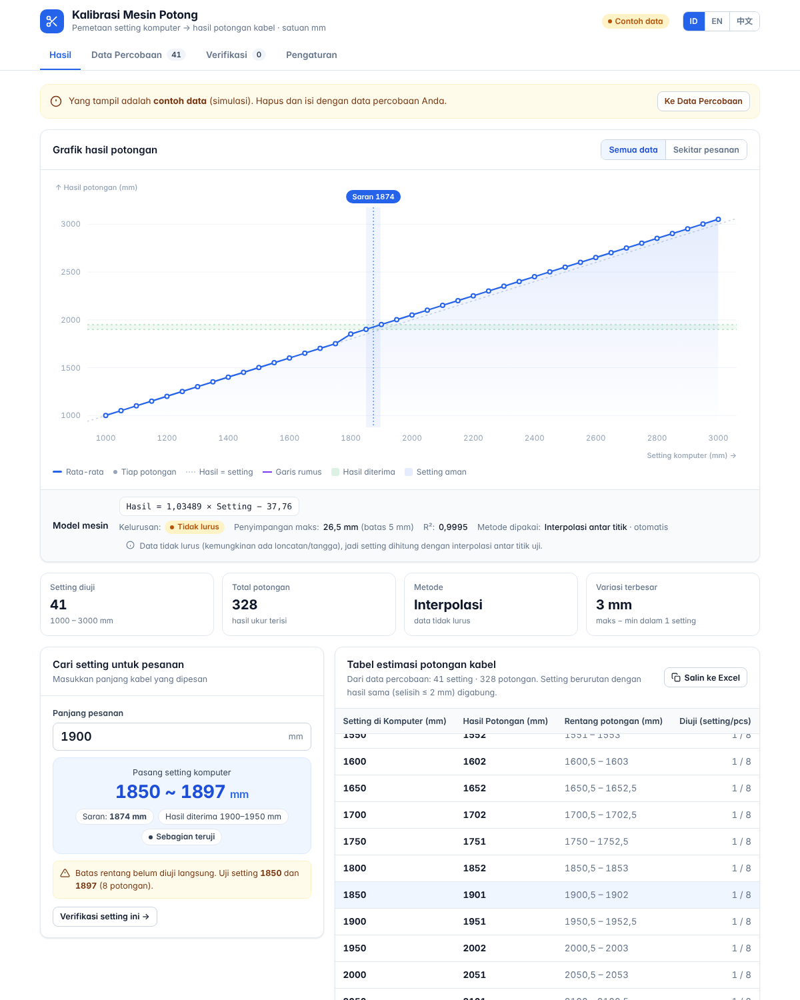
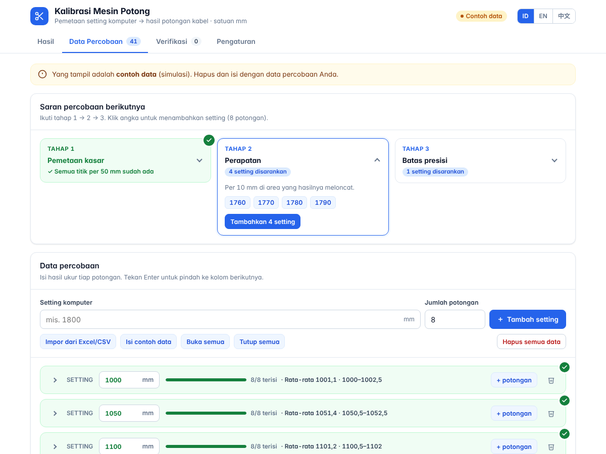

# Cutting Machine Calibration · Kalibrasi Mesin Potong

Web app statis untuk memetakan **setting komputer mesin potong kabel → hasil potongan aktual**, lalu membuat tabel setting untuk setiap panjang pesanan (PO).

Contoh hasil akhir (disusun langsung dari data percobaan):

| Setting di Komputer (mm) | Hasil Potongan (mm) |
|---|---|
| 1800 ~ 1840 | 1850 |
| 1850 ~ 1890 | 1900 |
| 1900 | 1950 |

Jika ada pesanan kabel 1900 mm, operator memasang setting di rentang yang hasilnya masuk toleransi pesanan, misalnya **1850 ~ 1890 mm**.



---

## Latar belakang

Toleransi mesin potong tidak konstan di semua ukuran. Hubungan antara setting di komputer dan hasil potongnya juga belum diketahui, dan bisa bertangga atau meloncat. Karena itu hubungan tersebut perlu dipetakan dari data percobaan: setiap setting dipotong beberapa kali (default 8 potongan), lalu hasilnya diukur.

## Fitur

**Tab Hasil**
- Grafik interaktif hasil potongan vs setting. Arahkan kursor (atau ketuk) titik, garis, atau area untuk melihat nilainya. Ada mode *Semua data* dan *Sekitar pesanan* (zoom ±150 mm).
- Panel **Model mesin**: rumus garis lurus `Hasil = b × Setting + a`, R², penyimpangan maksimum, dan keputusan apakah data lurus.
- Ringkasan: jumlah setting diuji, total potongan, metode, variasi terbesar.
- **Cari setting untuk pesanan**: masukkan panjang pesanan, lalu muncul rentang setting aman beserta saran nilai tengah.
- **Tabel estimasi potongan kabel** disusun langsung dari data percobaan:
  - Satu baris per setting yang diuji. Setting berurutan dengan hasil sama (selisih rata-rata ≤ 2 mm) digabung menjadi satu rentang, misalnya `1800 ~ 1840 → 1850`.
  - Kolomnya: hasil potongan (rata-rata), rentang potongan (min–maks), dan jumlah setting/potongan yang diuji.
  - Baris yang semua potongannya masuk toleransi pesanan yang sedang dicari diberi warna biru.
  - Tombol **Salin ke Excel**.
- Ringkasan per setting: rata-rata, min, maks, selisih, variasi.

**Tab Data Percobaan**
- **Saran percobaan bertahap** (dropdown, berwarna hijau dan bercentang saat selesai):
  1. **Pemetaan kasar**, dengan dua pilihan:
     - *Rekomendasi*: per 50 mm di rentang pesanan.
     - *Manual*: mengikuti setting yang ditambahkan sendiri.
  2. **Perapatan**: per 10 mm di area yang hasilnya meloncat.
  3. **Batas presisi**: per mm di titik loncatan dan batas rentang tabel.
- Input **satu kolom per potongan**:
  - Validasi otomatis: merah jika bukan angka atau selisih >10% dari setting.
  - Enter untuk pindah ke kolom berikutnya.
  - Tombol × untuk menghapus potongan.
  - Setiap setting bisa dibuka/tutup (dropdown).
- Impor dari Excel/CSV (2 kolom: setting, hasil).

**Tab Verifikasi**
- Potong 8 pcs di setting yang dipakai untuk pesanan nyata, lalu isi hasilnya. Statusnya **LULUS** jika semua potongan masuk rentang pesanan, **GAGAL** jika tidak.

**Tab Pengaturan**
- Toleransi pesanan: boleh kurang / boleh lebih (default 0 / +50 mm).
- Rentang pemetaan untuk saran Tahap 1 Rekomendasi (default 1000–3000 mm, per 50 mm).
- Metode perhitungan: *Otomatis* (disarankan), *Rumus garis lurus*, atau *Interpolasi antar titik*.

**Umum**
- Bahasa **Indonesia / English / 中文**: tombol di kanan atas, pilihan tersimpan.
- Data tersimpan otomatis di browser (localStorage).
- Responsif untuk desktop dan HP. Satu file `index.html` tanpa server dan tanpa build.

## Cara pakai

1. Buka tab **Pengaturan**, cek toleransi dan rentang pesanan.
2. Buka tab **Data Percobaan**, klik **Hapus semua data** (dua kali) untuk membuang contoh data.
3. Di **Tahap 1**, pilih *Rekomendasi* lalu **Tambahkan … setting**, atau pilih *Manual* lalu tambah setting sendiri.
4. Potong 8 kali di setiap setting, ukur hasilnya, lalu isi kolom Potongan 1–8.
5. Ikuti **Tahap 2** dan **Tahap 3** sampai semua tahap bercentang hijau.
6. Di tab **Hasil**, cari pesanan atau salin tabel estimasi ke Excel.
7. Verifikasi setting di produksi lewat tab **Verifikasi**.



## Metode perhitungan

- **Setting aman** untuk pesanan `P` adalah setting yang prediksi **semua** potongannya masuk `[P − boleh kurang, P + boleh lebih]`. Contoh: pesanan 1900 dengan aturan 0/+50 → hasil harus 1900–1950.
- **Interpolasi antar titik**: nilai min dan maks hasil di antara dua setting yang diuji diinterpolasi linear, lalu rentang aman dicari per 1 mm.
- **Rumus garis lurus**: regresi linear dari semua potongan. Sebaran tiap potongan terhadap garis (residual min/maks) dipakai sebagai batas prediksi. Setting saran = `(P + tengah toleransi − a) / b`.
- **Otomatis**: memakai rumus jika data lurus, yaitu rata-rata tiap setting menyimpang ≤ 5 mm dari garis dan ada minimal 3 setting. Selain itu memakai interpolasi.
- Label status pada hasil pencarian pesanan:
  - **Teruji**: kedua batas rentang sudah diuji langsung.
  - **Sebagian teruji** / **Perkiraan**: batas dihitung dari model dan perlu diuji (Tahap 3).
- **Tabel estimasi** hanya berisi setting yang benar-benar diuji, tanpa interpolasi. Pengelompokan: setting berurutan digabung jika rata-rata hasilnya berbeda ≤ 2 mm.
- Rentang hasil perpanjangan rumus di luar setting yang pernah diuji selalu diberi peringatan.

## Struktur repo

```
index.html            # seluruh aplikasi (HTML + CSS + JS, tanpa dependensi selain font Inter)
docs/hasil.png        # screenshot tab Hasil
docs/data-percobaan.png
README.md
```

## Menjalankan & deploy

- **Lokal**: buka `index.html` langsung di browser.
- **GitHub Pages**: Settings → Pages → *Deploy from a branch* → `main` / root. Aplikasi akan tersedia di
  `https://bagusbernadi.github.io/cutting-machine-calibration/`.

## Batasan

- Data disimpan di **browser masing-masing perangkat** (localStorage). Data tidak otomatis tersinkron antar perangkat atau antar pengguna, dan bisa hilang jika cache browser dibersihkan. Untuk berbagi, gunakan **Salin ke Excel** atau impor CSV.
- Contoh data bawaan adalah **simulasi** (mesin bertangga 1000–3000 mm), bukan data mesin nyata.
- Tidak ada fitur unduh file (CSV/Excel) di dalam pratinjau artifact. Fitur ini bisa ditambahkan setelah aplikasi berjalan di GitHub Pages.

---

Dibuat oleh Bagus Bernadi · Process Engineering
